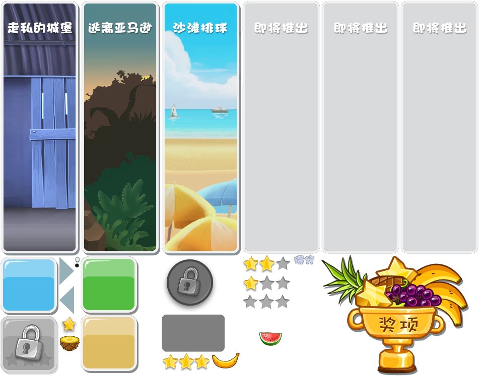

# ArgryBird

一款使用 **Unity 2022.3** 开发的 2D 弹弓物理闯关游戏，玩法参考《愤怒的小鸟》。仓库中同时包含**完整工程源码**与**可直接运行的 Windows 版本**，无需安装 Unity 即可开玩。

> **直接下载游戏**：[ArgryBird-win64.zip](https://github.com/LXJ6668848/ArgryBird/releases/download/v1.0.0/ArgryBird-win64.zip)（38 MB，解压即玩）



---

## 游戏简介

玩家用弹弓把小鸟弹射出去，撞毁由木板、石块和玻璃搭成的建筑，消灭关卡中所有绿猪即可过关。每关根据通关时剩余的小鸟数量评定 **1～3 颗星**。

- **核心玩法**：拖拽弹弓瞄准 → 松手弹射 → 利用物理碰撞连锁破坏建筑
- **物理系统**：基于 Unity 2D 刚体与碰撞，建筑会真实坍塌、坠落、连锁撞击
- **小鸟技能**：4 种小鸟，飞行途中可再次点击释放特殊技能
- **关卡评价**：三星评级 + 撞击飘分（3000 / 5000 / 10000 分档）

---

## 下载与安装（只想玩，不想装 Unity）

### 方式一：下载打包好的游戏（推荐）

1. 打开本仓库的 [Releases](https://github.com/LXJ6668848/ArgryBird/releases/latest) 页面
2. 下载 `ArgryBird-win64.zip`
3. 解压到任意目录（建议路径不含中文与空格）
4. 双击 `ArgryBird.exe` 开始游戏

### 方式二：直接使用仓库内的构建版本

1. 在仓库首页点击 **Code → Download ZIP**，下载并解压
2. 进入 `ArgryBirdAPP` 文件夹
3. 双击 `ArgryBird.exe` 运行

> **注意**：`ArgryBird.exe` 不能单独拷走运行，必须与同目录下的 `ArgryBird_Data`、`MonoBleedingEdge`、`UnityPlayer.dll` 保持在一起。

### 系统要求

| 项目 | 要求 |
| --- | --- |
| 操作系统 | Windows 10 / 11（64 位） |
| 磁盘空间 | 约 200 MB |
| 运行库 | 无需额外安装（Mono 运行时已随包提供） |
| 输入设备 | 鼠标（必需） |

### 首次启动提示

游戏未做代码签名，Windows SmartScreen 可能弹出"Windows 已保护你的电脑"。点击 **更多信息 → 仍要运行** 即可。

---

## 操作说明

| 操作 | 说明 |
| --- | --- |
| 按住鼠标左键拖拽小鸟 | 拉动弹弓皮筋，调整角度与力度 |
| 松开左键 | 发射小鸟 |
| 飞行中点击左键 | 释放当前小鸟的特殊技能 |
| 右上角暂停按钮 | 暂停 / 继续 / 重新开始 / 返回选关 |

### 小鸟类型与技能

| 小鸟 | 外观 | 技能（飞行中点击左键） |
| --- | --- | --- |
| 红鸟 | 红色 | 无技能，基础弹射 |
| 黄鸟 | 黄色 | 瞬间加速，适合击穿木质结构 |
| 黑鸟 | 黑色 | 立即爆炸，对周围建筑造成范围伤害 |
| 大嘴鸟 | 大头造型 | 立即掉头反向飞行，可回身补击 |

> 技能每只鸟只能使用一次；小鸟落地静止后会自动切换下一只，小鸟用完仍未消灭全部绿猪即判负。

---

## 从源码运行（开发者）

**环境要求**：Unity Hub + **Unity 2022.3.62f3c1**（使用 URP 14.0.12、TextMesh Pro、Unity 2D 功能集）

```bash
git clone https://github.com/LXJ6668848/ArgryBird.git
```

1. 打开 Unity Hub → **Add → Add project from disk**，选择克隆下来的 `ArgryBird` 目录
2. 用 Unity 2022.3.62f3c1 打开工程（首次导入需要几分钟，会自动生成 `Library` 目录）
3. 在 `Assets/Scenes` 中打开 `1-StartScene.unity`，点击 **Play** 运行
4. 重新打包：**File → Build Settings → Windows, Mac, Linux → Windows x86_64 → Build**

> 场景顺序必须为 `1-StartScene` → `2-LevelSelect` → `3-GameScene`，否则场景跳转会失败。

---

## 项目结构

```
ArgryBird/
├── Assets/
│   ├── Scenes/         1-StartScene（开场）2-LevelSelect（选关）3-GameScene（战斗）
│   ├── Scripts/        Bird / Slingshot / Destructiable / Pig / GameManager / AudioManager
│   │   ├── UI/         暂停、结算、星级、选关等界面逻辑
│   │   └── SO/         GameSO / MapSO（关卡星级与选关状态）
│   ├── Prefabs/        RedBird / YellowBird / BlackBird / BigMouthBird / Slingshot 等
│   ├── Resources/Map1/ Level1 ~ Level4 关卡预制体
│   ├── Image/ Music/   美术与音频素材
│   └── Settings/       URP 渲染管线配置
├── Packages/           Unity 包依赖清单
├── ProjectSettings/    工程设置（输入、图形、构建场景列表）
└── ArgryBirdAPP/       已打包的 Windows 可执行版本
```

---

## 当前进度与已知限制

- 第一章「走私的城堡」共 **4 关**，可完整游玩
- 选关界面预留 6 个章节位，其余章节标注"即将推出"，暂无对应关卡数据，点击后关卡列表为空
- 星级与最高分记录在 ScriptableObject 中，**仅本次运行内有效**，退出游戏后重置（尚未接入本地存档）
- 仅提供 Windows 64 位构建，macOS / Linux 需自行从源码打包
- 游戏内 UI 与关卡名称为中文

---

## 版权与致谢

- 工程代码由本项目作者编写，仅用于学习与技术演示
- 游戏美术、音效素材版权归 **Rovio Entertainment（《愤怒的小鸟》）** 所有，此处仅作非商业性的学习用途使用；如有侵权请通过 Issue 联系，将立即删除相关内容
- 本项目与 Rovio Entertainment 无任何关联，请勿用于商业用途

---

## 反馈

遇到问题或有改进建议，欢迎提交 [Issue](https://github.com/LXJ6668848/ArgryBird/issues)。
